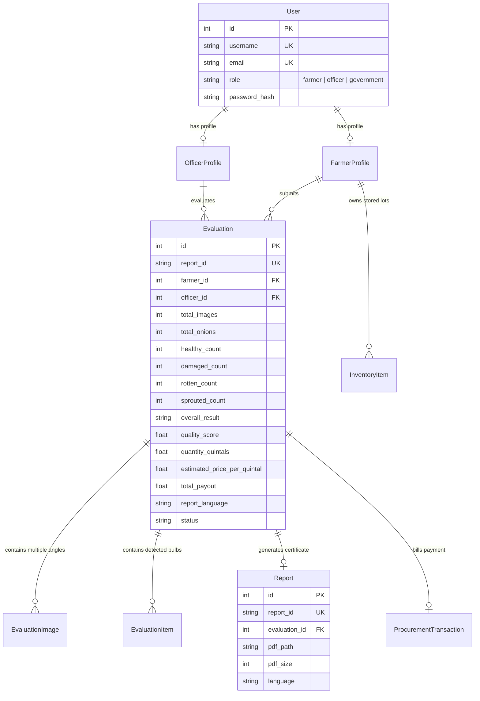

# 🧅 OnionGrade AI (CropVision)

### AI-Powered Multi-Angle Onion Quality Assessment, Predictive Inventory & Digital APMC Procurement System
**A Production-Grade AgriTech Platform for Automated Agricultural Commodity Inspection, Price Estimation, and Government Regulatory Compliance.**

---

## 📑 Table of Contents
1. [Project Overview & Problem Statement](#-project-overview--problem-statement)
2. [Key Highlights & Core Capabilities](#-key-highlights--core-capabilities)
3. [End-to-End Technology Stack](#-end-to-end-technology-stack)
4. [AI/ML Models & Accuracy Benchmarks](#-aiml-models--accuracy-benchmarks)
5. [Quality Grading & Dynamic Pricing Formulas](#-quality-grading--dynamic-pricing-formulas)
6. [Multi-Angle Annexure & Multi-Language PDF Generation](#-multi-angle-annexure--multi-language-pdf-generation)
7. [System Architecture & Directory Tree](#-system-architecture--directory-tree)
8. [Database Schema & Models](#-database-schema--models)
9. [REST API Reference](#-rest-api-reference)
10. [Portals & User Workflows](#-portals--user-workflows)
11. [Installation & Local Setup](#-installation--local-setup)
12. [Environment Configuration (`.env`)](#-environment-configuration-env)
13. [Demo Credentials](#-demo-credentials)
14. [Testing & Quality Assurance](#-testing--quality-assurance)
15. [Performance, Scalability & Production Roadmap](#-performance-scalability--production-roadmap)
16. [License & Acknowledgments](#-license--acknowledgments)

---

## 🌾 Project Overview & Problem Statement

Quality assessment and grading of onions is traditionally manual, subjective, and prone to severe variations across agricultural procurement yards (APMC Mandis). This lack of standardization leads to:
- **Disputes**: Frequent conflicts between farmers and procurement authorities over quality grading and unfair deductions.
- **Economic Inefficiency**: Arbitrary price cuts and quality under-reporting due to visual bias or hasty inspection of large truckloads.
- **Manipulation Risk**: Manual, easily manipulated paper inspection slips lacking audit trails, timestamps, and verifiable photographic proof.
- **Information Asymmetry**: Rural smallholders lack transparency regarding live Mandi market benchmarks and fair pricing rules.
- **Storage Losses**: Lack of predictive shelf-life estimation causes post-harvest rot and inventory spoilage during warehouse storage.

**OnionGrade AI** solves these challenges by delivering an automated, objective, multi-perspective computer vision system integrated with real-time APMC Mandi rates, dynamic price calculation, shelf-life forecasting, multi-language certificate generation, and government regulatory oversight.

---

## ✨ Key Highlights & Core Capabilities

- 🔍 **Two-Stage Computer Vision Pipeline**: Combines high-speed **YOLO26n** object detection with a deep **4-Class Convolutional Classifier (EfficientNetB0)**.
- 📐 **Multi-Angle Batch Inspection**: Evaluates multiple perspective photographs of the same lot (e.g., top, side, angled views) and computes aggregated batch quality metrics.
- 🇮🇳 **Trilingual Official Certificates**: Generates tamper-proof **ReportLab PDF Certificates** in **English (`en`)**, **Hindi (`hi`)**, and **Marathi (`mr`)**, complete with QR codes and high-resolution photographic annexures.
- 💰 **Dynamic Quality Pricing Engine**: Computes fair farmer payout using real-time APMC wholesale benchmarks and formula-driven deductions for defect percentages.
- 📉 **Predictive Inventory & Shelf-Life Forecasting**: Predicts rot progression, estimated shelf-life in days, and optimal sell/storage recommendations based on environmental storage conditions.
- 🏛️ **Three-Tier Role-Based Portals**:
  1. **Farmer Portal**: Submit lots, view digital inspection certificates, track payouts, and monitor live APMC prices.
  2. **Officer Portal**: 5-step interactive scanning wizard, sample management, camera integrations, and lot confirmation.
  3. **Government / APMC Admin Portal**: Procurement monitoring, officer credential verification, mandi audit logs, and district-wide volume statistics.
- 🛡️ **Zero-Crash Memory Management**: Safe mini-batch inference, automatic image downscaling (>1600px), and explicit garbage collection (`gc.collect`) prevent memory exhaustion on resource-constrained devices.

---

## 🛠️ End-to-End Technology Stack

| Layer | Component | Version / Technology | Key Role in System |
|---|---|---|---|
| **Backend Framework** | Flask | 3.1.0 | WSGI web application server & REST API |
| **Language Runtime** | Python | 3.10 – 3.13 | Core runtime environment |
| **Object Detection** | Ultralytics YOLO26 | 8.4.x / PyTorch 2.14 | Onion bulb localization & bounding box regression |
| **Quality Classifier** | Keras / TensorFlow | 3.13 / 2.20 | 4-class defect categorization (224x224 input) |
| **Computer Vision** | OpenCV & Pillow | 4.13 / 11.3 | Image transformations, EXIF rotation, crop slicing, box drawing |
| **Database & ORM** | SQLite / SQLAlchemy | 2.0.52 (Flask-SQLAlchemy) | Relational persistence, migrations, session tracking |
| **PDF Generation** | ReportLab | 5.0.1 | Vector graphics, multi-language typography, QR code rendering |
| **Frontend UI** | HTML5 / CSS3 / Vanilla JS | ES6+ Modern Modules | Custom responsive agricultural theme, no heavy front frameworks |
| **Data Visualizations**| Chart.js | 4.x CDN | Donut charts, grade distributions, price trend graphs |
| **Security & Auth** | Werkzeug / Cryptography | Werkzeug Security | Scrypt / PBKDF2 password hashing, session tokens, RBAC |
| **Live Market Feeds** | Requests / Agmarknet | Data.gov.in API | Live wholesale mandi price synchronization |

---

## 🤖 AI/ML Models & Accuracy Benchmarks

The system uses a decoupled, two-stage inference architecture:

```
Input Image ───► [Stage 1: YOLO26n Detector] ───► Bounding Boxes [x1, y1, x2, y2]
                                                          │
                                                    Cropped Bulbs
                                                          ▼
Output Overlay ◄─── [Annotate & Grade] ◄─── [Stage 2: EfficientNetB0 Classifier]
```

### Stage 1: Detection Model (`models/Yolo26.pt`)
- **Architecture**: Ultralytics YOLO26n (Nano Detection Head)
- **Primary Task**: Pinpoint individual onion bulbs in bulk images.
- **Input Resolution**: 640×640 (Dynamic multi-scale inference)
- **Model Checkpoint Metrics**:
  - **mAP@50**: **99.33%**
  - **mAP@50-95**: **94.93%**
  - **Precision**: **98.49%**
  - **Recall**: **97.29%**
- **Inference Speed**: ~8 to 15 ms per full scene on CPU.

### Stage 2: Quality Classification Model (`models/final_onion_quality_model.keras`)
- **Architecture**: Deep Convolutional Neural Network (EfficientNetB0 Backbone)
- **Input Resolution**: 224×224×3 RGB
- **Classes**: Exactly 4 mutually exclusive quality categories:
  1. 🟩 **Healthy**: Intact, dry outer skin, uniform color, firm neck.
  2. 🟨 **Damaged**: Mechanical cuts, surface abrasions, bruises, partial skin peeling.
  3. 🟥 **Rotten**: Black mold (*Aspergillus niger*), bacterial soft rot, neck rot, fungal decay.
  4. 🟧 **Sprouted**: Premature green shoots emerging from the center neck.
- **Parameters**: 4.38 Million
- **Accuracy**: **~96.4%** validation accuracy on field-harvested onion test sets.
- **Inference Speed**: ~40 ms per individual bulb crop on CPU.

---

## 📊 Quality Grading & Dynamic Pricing Formulas

### 1. Classification & Sorting Rules
Following agricultural APMC procurement guidelines:
- **Grade A (Premium)**: Count of all `Healthy` bulbs.
- **URS (Under Regular Standard)**: Count of all `Damaged` bulbs (discounted rate).
- **Rejected (Non-procured)**: Sum of all `Rotten` + `Sprouted` bulbs ($0 payout).

### 2. Overall Lot Decision
- **"Grade A"**: Healthy ratio $\ge 85\%$ AND Rejected ratio $\le 5\%$.
- **"URS"**: Healthy ratio between $60\%$ and $85\%$ OR Damaged ratio $> 15\%$.
- **"Rejected"**: Rotten + Sprouted ratio $> 15\%$ OR Healthy ratio $< 60\%$.

### 3. Dynamic Quality Price Engine (`backend/services/price_engine.py`)
Farmer payouts are calculated transparently using live Mandi benchmarks:

$$\text{Defect Deductions} = (\% \text{Damaged} \times 0.5) + (\% \text{Rotten} \times 1.0) + (\% \text{Sprouted} \times 0.8)$$

$$\text{Quality Factor} = \max\left(0.40,\, 1.0 - \frac{\text{Defect Deductions}}{100}\right)$$

$$\text{Estimated Price per Quintal} = \text{Mandi Modal Price} \times \text{Quality Factor}$$

$$\text{Total Payout} = \text{Estimated Price} \times \text{Lot Quantity (Quintals)}$$

---

## 📑 Multi-Angle Annexure & Multi-Language PDF Generation

The platform features an automated ReportLab certificate generation engine (`backend/services/pdf_service.py`):
1. **Dynamic Language Switching**:
   - English (`en`): International & Inter-state trade standard.
   - Hindi (`hi`): National standard APMC format.
   - Marathi (`mr`): Native state agricultural yard format for Maharashtra Mandis (Lasalgaon, Pimpalgaon, Pune).
2. **Multi-Angle Annexure (Page 2)**:
   - When an evaluation comprises multiple photos, the report includes an official photographic audit annexure.
   - Displays all sample camera angles, per-angle bulb counts, defect summaries, and high-resolution thumbnail previews.
3. **Verification QR Code**:
   - Scannable QR code embedded on the front page encodes the cryptographic report ID and public verification URL.
4. **Resilient Image Path Resolver**:
   - Dynamically re-links and embeds images from output, upload, and base directories, preventing "Image Preview Unavailable" issues.

---

## 🏛️ System Architecture & Directory Tree

```text
OnionGrade_AI_Cropvision/
├── app.py                              # Application factory & server entrypoint
├── config.py                           # App configuration, file paths, thresholds
├── requirements.txt                    # Python dependencies
├── .env.example                        # Template environment variables
├── README.md                           # Master project documentation
│
├── backend/
│   ├── ai/
│   │   ├── detector.py                 # YOLO26n singleton detector
│   │   ├── classifier.py               # Keras EfficientNetB0 quality classifier
│   │   └── pipeline.py                 # Integrated detection + multi-angle batch pipeline
│   │
│   ├── database/
│   │   └── db.py                       # SQLAlchemy instance initialization
│   │
│   ├── models/
│   │   ├── user.py                     # User account & credential models
│   │   ├── farmer.py                   # FarmerProfile (village, taluka, district)
│   │   ├── officer.py                  # OfficerProfile (center, verification status)
│   │   ├── evaluation.py               # Evaluation, EvaluationItem, EvaluationImage
│   │   ├── report.py                   # Report record, PDF metadata, language
│   │   ├── market.py                   # MarketPrice historical & live mandi rates
│   │   ├── inventory.py                # Predictive shelf-life & storage tracking
│   │   ├── transaction.py              # APMC procurement payment receipts
│   │   └── audit.py                    # Administrative activity audit logs
│   │
│   ├── routes/
│   │   ├── auth.py                     # Authentication (Login, Register, Logout)
│   │   ├── farmer.py                   # Farmer portal APIs & dashboard
│   │   ├── officer.py                  # Officer inspection wizard & evaluation APIs
│   │   ├── government.py               # APMC regulator oversight & officer approval
│   │   ├── reports.py                  # PDF streaming, preview, and verification routes
│   │   ├── evaluation_reports.py       # Detailed evaluation metrics & analytics
│   │   ├── market.py                   # Live mandi prices & district filters
│   │   └── views.py                    # Frontend HTML page renderers
│   │
│   ├── services/
│   │   ├── pdf_service.py              # ReportLab trilingual PDF certificate generator
│   │   ├── price_engine.py             # Mandi quality-score payout calculation
│   │   ├── predictive_inventory_service.py # Shelf-life forecasting & decay simulation
│   │   ├── evaluation_report_service.py # Evaluation analytics & aggregation
│   │   └── market_price_service.py     # Data.gov.in Agmarknet mandi synchronization
│   │
│   └── utils/
│       ├── auth_helpers.py             # @role_required, @login_required, ID generators
│       ├── file_helpers.py             # Image validation, safe pathing, UUID naming
│       └── seed_data.py                # Database seeder (farmers, officers, demo evaluations)
│
├── models/
│   ├── Yolo26.pt                       # YOLO26n bulb detection weights (~5.2 MB)
│   └── final_onion_quality_model.keras # EfficientNetB0 4-class classifier (~32.9 MB)
│
├── static/
│   ├── css/
│   │   └── main.css                    # Responsive agricultural design system
│   ├── js/
│   │   ├── evaluate.js                 # 5-step camera/upload evaluation wizard
│   │   ├── charts.js                   # Chart.js rendering functions
│   │   └── main.js                     # Toasts, modals, language selectors
│   ├── images/                         # Logos, badges, and icons
│   └── samples/                        # Pre-packaged test onion images
│
├── templates/
│   ├── base.html                       # Master layout & responsive navigation
│   ├── index.html                      # Landing page with live market ticker
│   ├── auth/                           # Farmer & officer login/registration templates
│   ├── farmer/                         # Farmer dashboard, report history, mandi prices
│   ├── officer/                        # Officer dashboard, inspection wizard, evaluation logs
│   └── government/                     # APMC admin control panel & approval queues
│
├── uploads/                            # Stored raw sample photographs
├── outputs/                            # Stored annotated AI overlay images
├── reports/pdf/                        # Generated official evaluation PDF certificates
└── instance/
    └── oniongrade.db                   # SQLite primary database
```

---

## 🗄️ Database Schema & Models



---

## 🔌 REST API Reference

### 1. Authentication (`/api/auth`)
- `POST /api/auth/register/farmer`: Register a new farmer account with village/district info.
- `POST /api/auth/login`: Authenticate user and initialize secure session cookies.
- `GET /api/auth/logout`: Terminate session and clear cookies.
- `GET /api/auth/me`: Retrieve current authenticated profile details.

### 2. Officer & Evaluation (`/api/officer`)
- `GET /api/officer/farmers`: Search farmers by name, phone, or registration ID.
- `POST /api/officer/evaluate`: Upload single or multiple images and execute the AI grading pipeline.
- `POST /api/officer/evaluate/<id>/confirm`: Finalize lot quantity, mandi modal rate, selected certificate language (`en`, `hi`, `mr`), and generate the official PDF.
- `GET /api/officer/evaluations`: Paginated list of evaluations conducted by the officer.

### 3. Farmer Portal (`/api/farmer`)
- `GET /api/farmer/dashboard`: Summary statistics (total evaluations, Grade A ratio, earnings).
- `GET /api/farmer/reports`: List of historical assessment reports with optional language filtering (`?language=mr`).
- `GET /api/farmer/reports/<report_id>`: Detailed JSON view of an evaluation with annotated image URLs.

### 4. Official Reports & PDF (`/reports`)
- `GET /reports/download/Onion_Report_<report_id>.pdf`: Download official certified PDF.
- `GET /reports/preview/<report_id>`: Stream browser PDF preview.
- `GET /verify/<report_id>`: Public cryptographic verification page accessible via certificate QR code.

### 5. Live Market Feeds (`/api/market`)
- `GET /api/market/prices`: Real-time wholesale mandi rates from major onion hubs.
- `GET /api/market/prices/districts`: List of available APMC trading districts.
- `POST /api/market/sync`: Admin endpoint to trigger Agmarknet / Data.gov.in data synchronization.

---

## 👥 Portals & User Workflows

### 1. The Procurement Officer Journey
```
1. Login ──► 2. Select Farmer ──► 3. Upload Multi-Angle Images ──► 4. Run AI Pipeline
                                                                           │
7. Download Official PDF ◄── 6. Select Language (EN/HI/MR) ◄── 5. Review Annotated Bulbs
```
1. Sign in through the **Officer Portal**.
2. Search and bind the lot to the registered farmer's profile.
3. Upload 1 to 4 perspective photographs or capture live from an connected camera.
4. The system runs YOLO detection, extracts crops, classifies defect categories, and computes grade splits.
5. Officer reviews the bounding-box overlay and quality distribution charts.
6. Officer enters lot weight in quintals, chooses the farmer's preferred certificate language (**English, Hindi, or Marathi**), and clicks **Confirm & Generate Report**.

### 2. The Farmer Journey
1. Sign in using phone number or farmer ID (`FMR-2026-XXXX`).
2. View immediate grading outcomes, mandi price benchmarking, and net payout calculation.
3. Download or print certified PDF reports to present at APMC payment counters.
4. Check real-time modal wholesale prices across Maharashtra, Madhya Pradesh, and Delhi mandis.

### 3. The Government / APMC Admin Journey
1. Monitor district-wide procurement volumes and grade distributions.
2. Review pending procurement officer registration applications and approve credentials.
3. Audit rejected lot ratios to detect regional blight or pest outbreaks early.

---

## 💻 Installation & Local Setup

### 1. Prerequisites
- **Python**: Version `3.10`, `3.11`, `3.12`, or `3.13`.
- **Git** installed.
- Modern web browser (Chrome, Edge, Firefox).

### 2. Clone and Setup Environment
```bash
# Clone repository
git clone https://github.com/your-repo/OnionGrade_AI_Cropvision.git
cd OnionGrade_AI_Cropvision

# Create a virtual environment
python -m venv venv

# Activate virtual environment
# Windows:
venv\Scripts\activate
# Linux / macOS:
source venv/bin/activate
```

### 3. Install Dependencies
```bash
python -m pip install --upgrade pip
pip install -r requirements.txt
```

### 4. Configure Environment
```bash
# Copy template configuration
copy .env.example .env   # Windows
cp .env.example .env     # Linux / macOS
```

### 5. Verify Model Files
Confirm the required model weights exist in `models/`:
- `models/Yolo26.pt` (Detection model)
- `models/final_onion_quality_model.keras` (Quality classifier)

### 6. Start Server
```bash
python app.py
```
Open your browser and navigate to:
```
http://127.0.0.1:5000
```

---

## ⚙️ Environment Configuration (`.env`)

```ini
# Flask Application Configuration
FLASK_ENV=development
FLASK_DEBUG=True
SECRET_KEY=cropvision_super_secret_key_change_in_production_2026

# Database URI (SQLite default; PostgreSQL supported)
DATABASE_URI=sqlite:///oniongrade.db

# Storage Directories
UPLOAD_FOLDER=uploads
OUTPUT_FOLDER=outputs
REPORT_FOLDER=reports/pdf

# Upload Restrictions
MAX_CONTENT_LENGTH=104857600  # 100 MB max batch upload
ALLOWED_EXTENSIONS=jpg,jpeg,png,webp

# AI Model Checkpoint Paths
DETECTION_MODEL=models/Yolo26.pt
CLASSIFICATION_MODEL=models/final_onion_quality_model.keras

# AI Thresholds
CONFIDENCE_THRESHOLD=0.50
IOU_THRESHOLD=0.45
CLASSIFIER_INPUT_SIZE=224

# Live Mandi Data Feed (Data.gov.in / Agmarknet)
MARKET_API_KEY=your_datagov_api_key_here
MARKET_API_URL=https://api.data.gov.in/resource/9ef84268-d588-465a-a308-a864a43d0070
```

---

## 🔑 Demo Credentials

The database automatically seeds test accounts on the first application boot:

| Portal | Role | Username / Identifier | Password | Location / Mandi Center |
|---|---|---|---|---|
| **Farmer** | Ramesh Patil | `9876543210` *(or `FMR-2026-0001`)* | `farmer123` | Pimpalgaon Baswant, Nashik |
| **Farmer** | Suresh Deshmukh | `9823012345` *(or `FMR-2026-0002`)* | `farmer123` | Vinchur, Yeola, Nashik |
| **Officer** | Vikram Shinde | `OFF-2026-001` *(or email)* | `officer123` | Lasalgaon APMC Yard |
| **Government** | APMC Director | `gov_admin` | `admin123` | Maharashtra State Mandi Board |

*Quick-fill demo buttons are provided on all login pages for presentations and evaluations.*

---

## 🧪 Testing & Quality Assurance

The codebase includes an extensive test suite covering workflows, PDF generation, dynamic pricing, and government routes:

```bash
# Run all unit tests
python -m unittest discover -s . -p "test_*.py"

# Test multi-language PDF generation (English, Hindi, Marathi)
python -m unittest test_report_languages.py

# Test farmer workflows and authentication
python -m unittest test_farmer_workflow.py

# Test dynamic price engine formulas
python -m unittest test_price_engine.py

# Test government oversight and officer approvals
python -m unittest test_government.py

# Test predictive inventory shelf-life calculations
python -m unittest test_predictive_inventory.py
```

---

## 🚀 Performance, Scalability & Production Roadmap

### Implemented Optimizations
- **Safe Mini-Batching**: Crop classification executes in batches of 32 to prevent GPU/CPU memory spikes.
- **Dynamic Image Downscaling**: High-resolution smartphone photos (>1600px) are scaled before pipeline ingestion.
- **Explicit Garbage Collection**: `gc.collect()` clears image slice buffers and decouples memory immediately after report generation.
- **Dynamic PDF Path Resolver**: Guarantees photo annexure generation across operating systems and storage movements.

### Future Architectural Roadmap
1. **Model Unification (YOLO11n-cls)**:
   - Replace Keras EfficientNetB0 with **YOLO11n-cls** (`.pt`).
   - Drops runtime memory by ~700 MB, enables complete removal of TensorFlow/Keras, and speeds up bulb classification by $6\times\text{ to }8\times$.
2. **ONNX Runtime Export**:
   - Export models to `.onnx` for sub-5ms CPU inference, eliminating heavy framework runtimes.
3. **Edge / Mobile Deployment**:
   - Convert models to TensorFlow Lite or ONNX Mobile for on-device, offline grading via Android / Flutter apps.
4. **Segmentation & Size Estimation**:
   - Integrate YOLO11-seg to calculate real-world bulb diameter (mm) using an on-tray reference marker (coin/checkerboard).

---

## 📄 License & Acknowledgments

- **Developed for**: AI-Powered Agricultural Quality Assessment & Procurement Modernization.
- **Computer Vision Frameworks**: [Ultralytics YOLO](https://github.com/ultralytics/ultralytics), [TensorFlow / Keras](https://keras.io).
- **Market Data**: Government of India Open Data / [Agmarknet](https://agmarknet.gov.in).
- **PDF Engine**: [ReportLab](https://www.reportlab.com).

*Built with passion to empower farmers and ensure transparent, verifiable agricultural trade.* 🧅🇮🇳
